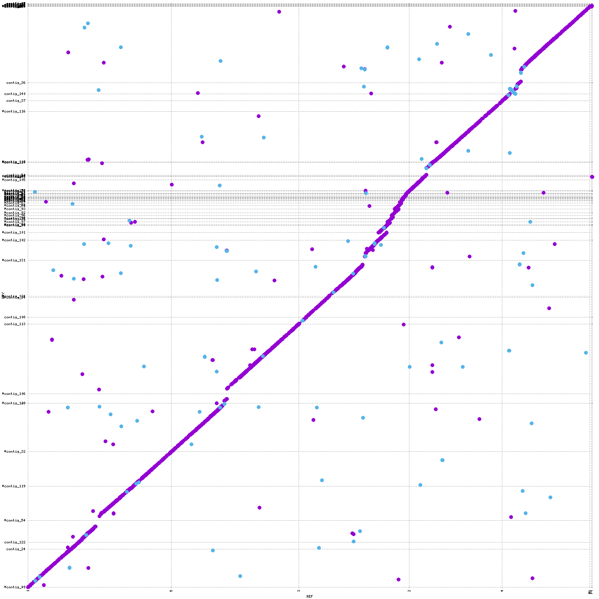
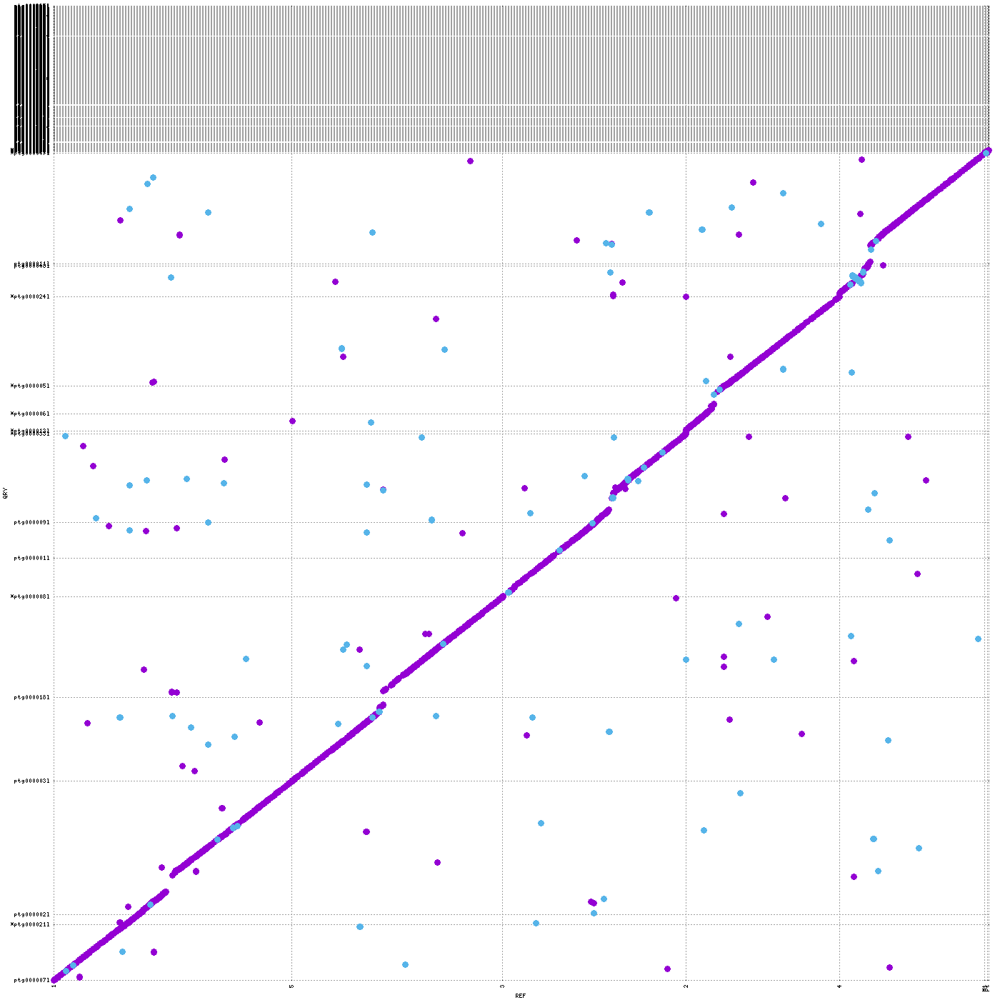
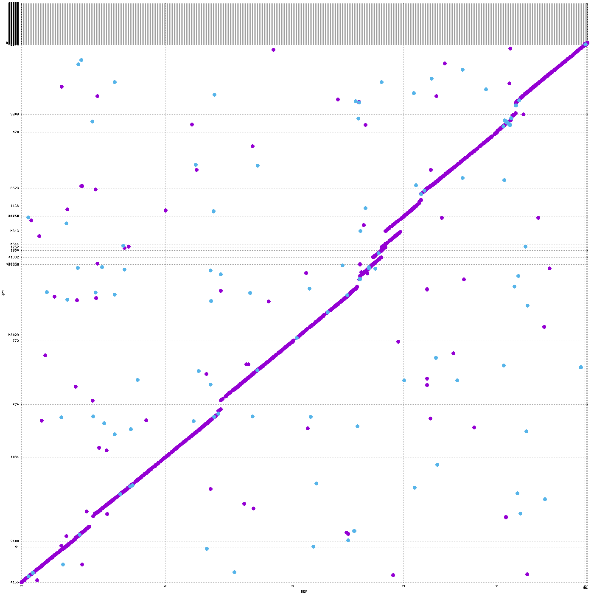
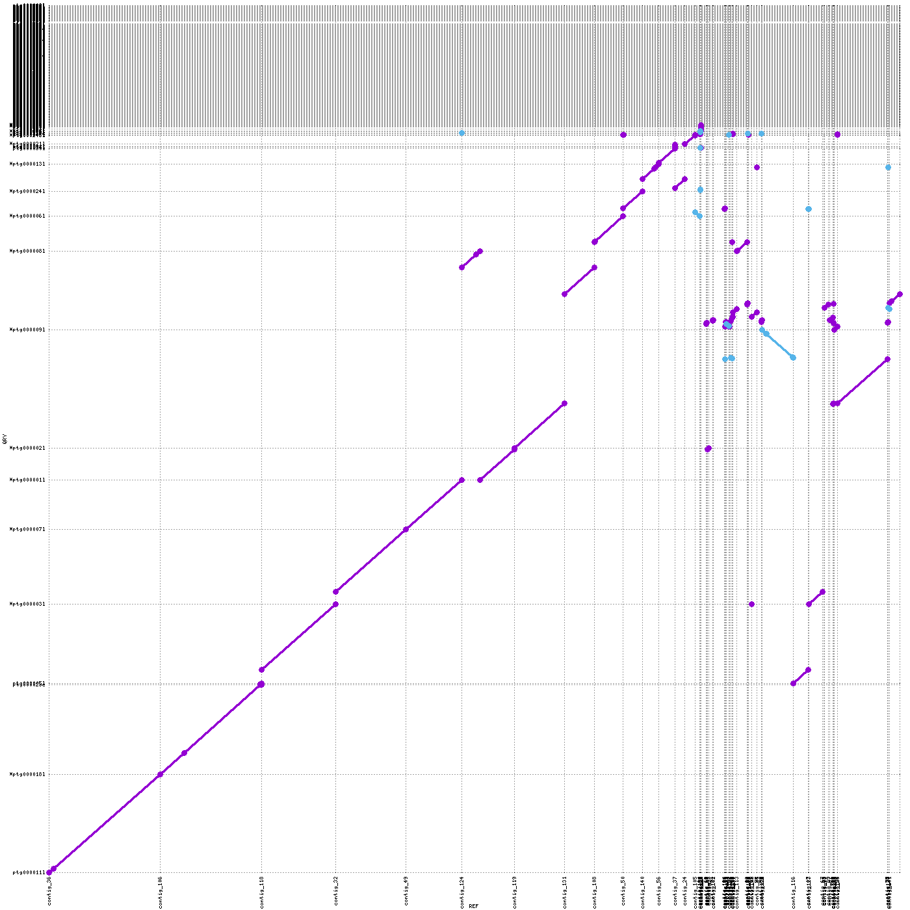
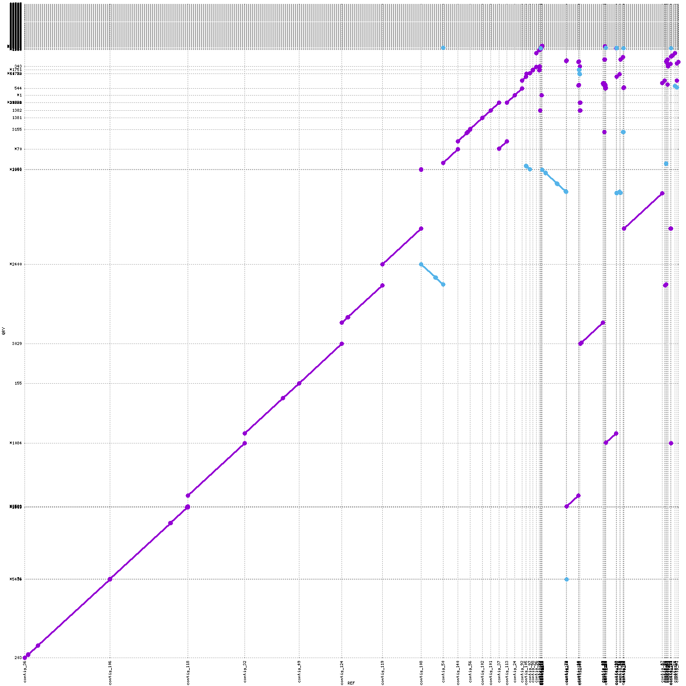
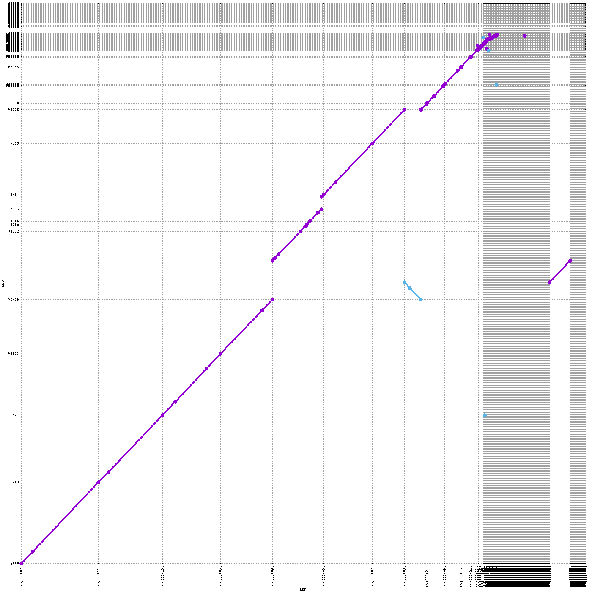

# Genome & Transcriptome Assembly Course

For the genome and transcriptome assembly, we worked with two types of sequencing data: PacBio HiFi genomic reads and Illumina paired-end RNA-seq reads.

The main tasks were:

- **Genome assembly** (PacBio HiFi, *Arabidopsis thaliana* accession **Lu-1**, SRA **ERR11437310**): read quality control, k-mer profiling, assembly with several long-read assemblers, assembly evaluation, and genome comparison against the TAIR10 reference and between assemblies.
- **Transcriptome assembly** (Illumina paired-end RNA-seq, SRA **ERR754081**): quality control, trimming and cleaning, assembly with Trinity, and BUSCO evaluation.

The PacBio HiFi data originate from the *Arabidopsis thaliana* pan-genome study of Lian et al. (2024), which sequenced 69 accessions.

## Repository structure

```text
assembly_annotation_course/
├── scripts/
│   ├── Week01_01_read_statistics.sh
│   ├── Week01_02_run_fastp.sh
│   ├── Week01_03_fastqc_trimmed_rnaseq.sh
│   ├── Week01_04_kmer_counting.sh
│   ├── Week02_01_run_flye.sh
│   ├── Week02_02_run_hifiasm.sh
│   ├── Week02_03_run_lja.sh
│   ├── Week02_04_run_trinity.sh
│   ├── Week03_01_run_busco.sh
│   ├── Week03_02_run_quast.sh
│   ├── Week03_03_launch_merqury.sh
│   ├── Week03_03a_run_meryl.sh
│   ├── Week03_03b_run_merqury.sh
│   ├── Week03_03c_summarize_merqury.sh
│   └── Week03_04_run_mummer.sh
├── reports/
│   ├── fastqc/
│   ├── fastp/
│   ├── busco/
│   ├── quast/
│   └── merqury/
├── images/
│   ├── genomescope/
│   ├── merqury/
│   └── mummer/
├── Exercise_Answers.md
└── README.md
```

Large intermediate files, raw reads, assembly outputs, BUSCO lineage databases, Meryl databases and other temporary analysis directories are not stored in Git.

## Workflow

| Step | Purpose | Tool(s) |
|---|---|---|
| 1. Read quality control | Assess read length, GC content and base quality | FastQC |
| 2. Trimming and cleaning | Remove adapters and low-quality RNA-seq reads | fastp |
| 3. K-mer analysis | Estimate genome size, k-mer coverage and heterozygosity | Jellyfish, GenomeScope |
| 4. Assembly | Assemble genome and transcriptome | Flye, hifiasm, LJA; Trinity |
| 5. Assembly assessment | Evaluate completeness, contiguity and consensus accuracy | BUSCO, QUAST, Merqury |
| 6. Genome comparison | Compare assemblies with TAIR10 and with each other | nucmer, mummerplot |

# Results

## 1. Read quality

### PacBio HiFi — Lu-1 (ERR11437310)

| Metric | Value |
|---|---:|
| Number of reads | 570,354 |
| Total bases | ~9.90 Gbp |
| Read length range | 62–46,056 bp |

### Illumina RNA-seq (ERR754081)

FastQC showed that the raw RNA-seq data required cleaning. After trimming, the per-base sequence quality improved and the overrepresented sequences detected in the raw reads were removed.

Selected FastQC reports are stored in `reports/fastqc/`.

## 2. Trimming and cleaning (fastp)

| Metric | Before filtering | After filtering |
|---|---:|---:|
| Total reads | 45,241,360 | 39,807,212 |
| Q20 bases | 88.9% | 93.8% |
| Q30 bases | 78.6% | 83.6% |

Additional fastp result:

| Parameter | Value |
|---|---:|
| Filtered reads | 5,434,148 (12.0%) |
| Adapter-trimmed reads | 3,510,455 |

Selected fastp reports are stored in `reports/fastp/`.

## 3. K-mer profile

### PacBio HiFi — Lu-1

| Accession | K-mer size | K-mer coverage | Genome size | Heterozygosity | Unique sequence |
|---|---:|---:|---:|---:|---:|
| Lu-1 | 21 | 31.96× | 135.3 Mb | ~0.052% | 77.3% |

The GenomeScope genome-size estimate is close to 135 Mb. The k-mer coverage reported here is the GenomeScope model coverage and should not be confused with the sequence-depth estimate calculated directly from total sequenced bases.

## 4. Completeness (BUSCO)

BUSCO lineage: `brassicales_odb10`.

C = complete, S = single-copy, D = duplicated, F = fragmented, M = missing.

| Assembly | C (%) | S (%) | D (%) | F (%) | M (%) |
|---|---:|---:|---:|---:|---:|
| Flye | 99.9 | 93.9 | 6.0 | 0.1 | 0.0 |
| hifiasm | 99.8 | 98.9 | 0.9 | 0.1 | 0.1 |
| LJA | 99.9 | 93.4 | 6.5 | 0.1 | 0.0 |
| Trinity | 78.9 | 39.3 | 39.6 | 3.5 | 17.6 |

All three genome assemblies are highly complete. Hifiasm has the highest proportion of single-copy BUSCOs and the lowest duplicated BUSCO fraction.

The Trinity BUSCO result should be interpreted differently from the genome assemblies. A transcriptome only contains genes expressed in the sampled tissue and condition, and alternative isoforms can increase the duplicated BUSCO fraction.

Selected BUSCO summary files are stored in `reports/busco/`.

## 5. Contiguity and reference comparison (QUAST)

| Assembly | # contigs | Total length | N50 | NG50 | L90 | N90 | Duplication ratio | Genome fraction (%) |
|---|---:|---:|---:|---:|---:|---:|---:|---:|
| Flye | 98 | 138,067,424 | 8,527,977 | 9,055,876 | 19 | 1,650,967 | 1.088 | 91.718 |
| hifiasm | 591 | 158,432,934 | 14,384,264 | 14,515,760 | 127 | 48,263 | 1.272 | 91.821 |
| LJA | 911 | 149,680,743 | 14,515,111 | 16,368,126 | 15 | 1,638,094 | 1.184 | 91.980 |

Flye has the fewest contigs and an assembly size closest to the GenomeScope estimate. Hifiasm and LJA have higher N50/NG50 values, while hifiasm also shows the highest duplication ratio.

Because Lu-1 and TAIR10 are different *A. thaliana* accessions, reference-based mismatch, indel and structural-difference counts should not automatically be interpreted as assembly errors.

Selected QUAST reports are stored in `reports/quast/`.

## 6. Consensus accuracy and k-mer completeness (Merqury)

| Assembly | Error k-mers | Total k-mers | QV | Error rate (per base) | ~1 error per bp | K-mer completeness (%) |
|---|---:|---:|---:|---:|---:|---:|
| Flye | 837 | 138,065,779 | 65.40 | 2.887e-07 | 3,464,007 | 99.23 |
| hifiasm | 8,751 | 158,421,114 | 55.80 | 2.630e-06 | 380,157 | 98.81 |
| LJA | 112,120 | 149,662,523 | 44.47 | 3.569e-05 | 28,022 | 99.34 |

Flye has the highest consensus QV and by far the lowest estimated error rate. LJA has the highest k-mer completeness, but its consensus QV is substantially lower.

Selected Merqury reports and spectra plots are stored in `reports/merqury/` and `images/merqury/`.

## 7. Final assembler choice

**Best overall assembler for Lu-1: Flye**

| Criterion | Flye | hifiasm | LJA | Best |
|---|---:|---:|---:|---|
| BUSCO complete | 99.9% | 99.8% | 99.9% | Flye = LJA |
| BUSCO single-copy | 93.9% | 98.9% | 93.4% | hifiasm |
| Merqury QV | 65.40 | 55.80 | 44.47 | Flye |
| ~1 error per bp | 3.46 Mb | 380 kb | 28 kb | Flye |
| Duplication ratio | 1.088 | 1.272 | 1.184 | Flye |
| # contigs | 98 | 591 | 911 | Flye |
| Genome fraction | 91.718% | 91.821% | 91.980% | LJA |
| N50 | 8.53 Mb | 14.38 Mb | 14.52 Mb | LJA |
| K-mer completeness | 99.23% | 98.81% | 99.34% | LJA |

Flye provides the best overall balance for Lu-1. It combines excellent BUSCO completeness with the highest Merqury QV, the lowest estimated error rate, the lowest duplication ratio of the three assemblies, the fewest contigs, and an assembly size close to the GenomeScope estimate. Hifiasm performs best for single-copy BUSCO recovery, while LJA has the highest contiguity and k-mer completeness.

## 8. Genome comparison (MUMmer)

Each assembly was compared with the TAIR10 reference and the assemblies were also compared pairwise.

### Assemblies vs. TAIR10

#### Flye vs. TAIR10



#### hifiasm vs. TAIR10



#### LJA vs. TAIR10



### Pairwise assembly comparisons

#### Flye vs. hifiasm



#### Flye vs. LJA



#### hifiasm vs. LJA



The detailed interpretation of the dotplots should distinguish genuine accession-specific differences from possible assembly differences. Lu-1 and TAIR10 are different *A. thaliana* accessions, so not every structural difference relative to TAIR10 represents an assembly error.

# References

1. Lian, Q. et al. (2024). *A pan-genome of 69 Arabidopsis thaliana accessions reveals a conserved genome structure throughout the global species range.* Nature Genetics, 56, 982–991.
